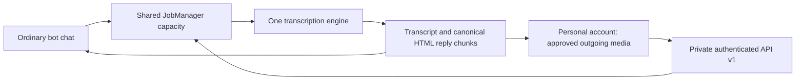

# Private transcription integration (API v1)

The main Telegram bot can expose an **opt-in, authenticated side entrance** for
Personal Auto Transcriber. It does not receive forwarded messages in its normal
Telegram chat. Both transports run in the **same Python process/event loop** and
call `bot.transcribe_media_bytes`: prompt building, model selection, key fallback,
retries, file/Live handling and final reply formatting have one implementation.
Updating and deploying the main service updates that engine for the personal
client too. A GitHub push alone does not update a running service.

## Boundaries and visibility

- Disabled by default. Ordinary processing history/settings remain compatible; the
  guided-settings release adds schema v6 interface preferences without changing API v1.
  API requests use explicit mode, original language (`auto`) and
  `clean`/`verbatim`, never the owner's settings in a different Telegram chat.
- The user-account client owns consent, watching outgoing media, deduplication
  and Telegram delivery. The server never receives its Telegram session, private
  recipient IDs, BotFather token or arbitrary URLs/file paths.
- API work shares global/per-owner active-job limits, is limited to **one API
  job and one upload at a time**, and never jumps ahead of the Telegram queue.
  If capacity is unavailable it returns 503 rather than buffering a new queue.
- Logs include source `personal-auto-transcriber`, hashed request ID and model;
  no body, transcription, bearer token or request query logging is enabled.
- The existing localhost-only admin dashboard shows a separate **Personal Auto
  Transcriber** section with request/status/engine-version/error metadata only.
  This does not make the admin panel safe to expose publicly.
- Authenticated `GET /v1/status` exposes API version, engine build revision and
  media size limit. Published images embed `${github.sha}`; unmarked local builds
  honestly report `unversioned`. Historical results retain their original engine
  version even after the running service is upgraded.

## Configure, do not deploy implicitly

Generate a separate random bearer token (at least 32 non-whitespace characters)
and inject the SAME token into the server and personal client via protected env
files/secret storage. Never reuse a Telegram token or commit the new token.

Server settings (see `.env.example`):

| Variable | Default | Meaning |
|---|---|---|
| `INTEGRATION_API_ENABLED` | `0` | `1` explicitly starts the API with the bot |
| `INTEGRATION_API_TOKEN` | unset | Required only when enabled |
| `INTEGRATION_API_HOST` | `127.0.0.1` | Bind loopback; Docker network example below |
| `INTEGRATION_API_PORT` | `8082` | Internal listener |
| `INTEGRATION_DATABASE_PATH` | sibling of `DATABASE_PATH`, `integration.sqlite3` | Separate private integration state |
| `INTEGRATION_PROCESSING_TIMEOUT` | `900` | Total seconds per accepted API job |
| `INTEGRATION_REQUESTS_PER_MINUTE` | `5` | New accepted API jobs, process-local limiter |
| `ENGINE_VERSION` | build revision / `unversioned` | Identifies the deployed main engine |

`ADMIN_USER_ID` must be configured and positive. `MAX_MEDIA_BYTES` is shared with
the main bot (default 20 MiB). This release bounds duration metadata to 0–3600
seconds; the engine's ffmpeg/model time/output guards still apply independently.

### Native processes on one host

Use `http://127.0.0.1:8082` in the personal client. Keep the listener on loopback.
No reverse proxy, public DNS or public port is required.

### Separate Docker Compose projects

`127.0.0.1` inside one container is NOT another container. The optional override
`docker-compose.integration.yml` attaches only the main bot to an existing private
Docker network, with a `transcription-engine` alias, and binds its API to
`0.0.0.0` **inside that container**. There is deliberately **no published host
port**. The personal client must join the same network and use
`http://transcription-engine:8082`.

Planned future setup (only after separately approved deployment): create a
dedicated user-defined Docker network named `transcription-integration`, then
include this override after the normal source/GHCR Compose file. An existing
Docker network with the same name is not automatically trustworthy: inspect its
members first. Do not attach unrelated containers. The bot also needs its normal
outbound network for Telegram/Gemini; an isolated `internal: true` network alone
would block that access.

Apply the same `INTEGRATION_DATABASE_PATH` to the read-only admin panel if a
custom path is used. The default sibling `/data/integration.sqlite3` works through
the existing shared data volume without giving the panel a bearer token.

## Wire contract

All routes require `Authorization: Bearer <token>`. No browser/CORS access is
configured. Never publish this API directly to the internet.

1. `GET /v1/status` → `{api_version: 1, source, engine: {name, version}, max_media_bytes}`.
2. `POST /v1/transcriptions` with raw bytes, `Content-Type` of supported audio/video
   and `X-Request-ID` = 64 lowercase SHA256 hex characters. Query fields:
   `media_type=voice|video`, `mode=both|transcription_only`,
   `duration_seconds=0..3600`, `transcription_type=clean|verbatim` (default clean).
   Unknown/duplicate parameters, compressed requests and empty bodies are rejected.
3. `GET /v1/transcriptions/{request_id}` polls the stored status. It always returns
   200 for known records, even when still processing. POST returns 202 while
   processing, otherwise 200 for a matching existing record.
4. Envelope: `api_version`, `source`, `engine`, `request_id`, `status`.
   Success `result` contains `transcription`, `summary`, `model_used`, `elapsed_ms`
   and `reply_chunks` (HTML-escaped/chunked by the main bot). A terminal failure has
   only a safe `error` code, not provider exception text.

Possible statuses: `processing`, `succeeded`, `failed`, `interrupted`.
HTTP 401 unauthorized; 400 malformed; 413 too large; 409 same ID with different
bytes/metadata; 429 rate limited; 503 busy/retention capacity. Busy responses carry
`Retry-After: 2`. API URLs and redirects are never used to download media.

## Idempotency, storage and operational limitations

The client hashes its own owner/chat/message identity into a stable request ID.
The server additionally fingerprints bytes + MIME type + explicit options. A
matching repeated POST retrieves the original work/result, **not another Gemini
call**. Different bytes/options with the same ID fail closed with 409. Keep the
same request ID when a POST acknowledgement is lost.

A separate SQLite file is created mode 0600. Raw media exists only in bounded
memory while uploading/processing, never in this DB. Results/identifiers are
retained across restart. Unfinished jobs become `interrupted` on graceful stop
or restart, and are NOT automatically re-run. This deliberately avoids hidden
provider charges. Failed/interrupted requests require an explicit owner recovery
workflow; the personal client must not silently pick its legacy engine.

Retention is bounded at 1000 request records and 512 KiB of serialized result per
record (plus SQLite overhead); on reaching capacity **new IDs are rejected**, old
IDs remain retrievable. No automatic purge is shipped: a purge/reset loses
idempotency history, so back up and coordinate it with the personal client's
processed-message state. No cross-process locking/singleton service discovery is
provided: run exactly one API-enabled main-bot process per integration DB. The
per-minute limiter is in memory and resets on restart; durable request IDs do not.

A stored successful model result does NOT prove that the personal account sent
its reply. Telegram network acknowledgements can be ambiguous; the client must
not blindly resend after an uncertain send or crash. There is no distributed
exactly-once delivery guarantee and no automatic crash replay in this release.
Existing Gemini usage quotas are shared, not isolated, even though job concurrency
and API rate limits are bounded.

## Prerequisite PRs and verification

This feature was developed over the combined snapshots of main-bot PRs **#20,
#21 and #22**. Merge prerequisites first, then this feature, then the matching
personal-client PR. Do not deploy the intermediate dependency-only state:
PR #20 requests `websockets>=17.2,<18`, but `google-genai 2.x` declares `<17`.
The feature deliberately restores `websockets>=13,<17` while retaining PR #20's
ancestry; the combined feature requirements resolve normally. No `--no-deps`,
ignored dependency check or fabricated compatible version is used.

Offline merge verification against main `b32e35974fd9e1b5be575e1d2ebd9126df356513`
and prerequisite heads `503db9a`, `c909cac`, `3b7fdad`:
- Normal prerequisite merges + this feature: clean merge, exact feature tree,
  full server suite passes.
- Squashed prerequisites + merge of the historical feature branch: conflicts in
  `bot.py`, `requirements.txt`, `tests/conftest.py`. Do not claim conflict freedom.
- Squashed prerequisites + cherry-pick of only the feature change: clean, exact
  feature tree, full suite passes. After actual prerequisite squash merges,
  rebase/recreate this feature from updated main using only commits after
  `6ca4725` (exclude the prerequisite merge itself), then rerun verification.
  This is a future branch-maintenance step, not a main merge/deployment approval.

Offline tests cover auth-before-body, request validation, bounded uploads/results,
persistent dedupe/conflicts, restart/timeout/shutdown behavior, shared capacity,
main-engine invocation, canonical escaping, and read-only admin visibility. Real
local HTTP client/server smoke tests use a fake model result, not Gemini. These
are not a live Telegram/Gemini acceptance test or a production deployment.
